  

# 🚀 Awesome HTTP Clients: Top API Clients & Testing Tools

  
  
  
  
  
  
  

---

> 🎯 **A comprehensive, SEO-optimized, curated guide to the best HTTP clients, API debuggers, REST GUI clients, command-line tools, and testing environments.** Discover top SaaS platforms with transparent pricing models alongside production-grade, Git-native, local-first, open-source Postman alternatives.

---

## 📑 Table of Contents

- [📊 Sector Overview & Market Dynamics](#-sector-overview--market-dynamics)
- [☁️ SaaS / Hosted API Platforms](#️-saas--hosted-api-platforms)
- [🔓 Open-Source GitHub Projects](#-open-source-github-projects)
- [⭐ Star History](#-star-history)
- [💖 Support & Sponsorship](#-support--sponsorship)
- [🤝 How to Contribute](#-how-to-contribute)
- [⚖️ Disclaimer](#️-disclaimer)

---

## 📊 Sector Overview & Market Dynamics

The global API client and automated testing market is estimated between **$1.8 Billion and $4.1 Billion** (projected to exceed **$13 Billion+** over the next decade at an ~18–22% CAGR), driven by microservices architecture adoption, shift-left testing in CI/CD pipelines, and stringent API compliance. 

The industry remains **moderately fragmented**: enterprise adoption and developer mindshare are heavily anchored by a few multi-billion-dollar platform incumbents (such as Postman and SmartBear), yet counter-balanced by an energetic, fast-growing ecosystem of local-first, Git-native, and terminal-first open-source utilities addressing developer pushback against forced cloud accounts and per-seat SaaS costs.

---

## ☁️ SaaS / Hosted API Platforms

A detailed evaluation of hosted API development ecosystems, featuring transparent starting tier pricing, free plan quotas, and company scale sorted in descending order:

| 🏷️ Platform | 🏢 Company Scale (Valuation / ARR) | 💳 Pricing (Starting Tier) | 🎁 Free Tier Limits | 🌟 Key Capabilities & Differentiators |
| :--- | :--- | :--- | :--- | :--- |
| **[Postman](https://www.postman.com/)** | **$5.6B** valuation (~$313M–$500M+ ARR) | **Basic**: $14 / user / month *(billed annually; $19/mo monthly)* | **Free forever plan**: 1 user, 25 collection runs/month, 10,000 public API requests/month, 1,000 mock calls/month | Comprehensive API lifecycle suite (design, mock, test, monitor), Postbot AI assistant, enterprise-grade governance. |
| **[SwaggerHub](https://swagger.io/tools/swaggerhub/)** *(SmartBear)* | **$1.8B+** parent valuation (~$150M–$200M+ ARR) | **Individual**: $19 / user / month *(billed annually; $25/mo monthly)* | **14-day free trial**: Full Team/Enterprise features (unlimited private APIs, role-based access); no ongoing free multi-user hosted plan | Industry-standard OpenAPI/Swagger specification management, enterprise API contract validation, design standardization. |
| **[Stoplight](https://stoplight.io/)** *(SmartBear)* | **$1.8B+** parent valuation *(Acquired by SmartBear)* | **Basic**: $39 / month *(includes 3 seats; $79/mo for Pro Team)* | **Free forever plan**: 1 user, 1 project, visual OpenAPI & JSON schema editor, hosted documentation, local mock servers | Design-first API architecture, visual schema editors, automated style governance and linting powered by Spectral. |
| **[ReadMe](https://readme.com/)** | **$200M+** valuation (~$11M ARR) | **Pro**: $250 / project / month *(billed annually; Starter is $0)* | **Free forever plan (Starter)**: 1 project, 1 published version, 24-hour API request log history, 1 user, community support | Interactive developer documentation hubs, live "Try-It" consoles, developer onboarding analytics and SDK generators. |
| **[Apidog](https://apidog.com/)** | **Bootstrapped** / Privately held *(Undisclosed ARR)* | **Basic**: $9 / user / month *(billed annually; $12/mo monthly)* | **Free forever plan**: 4 users included, unlimited test runs, 5 projects, visual assertion engine | Visual assertions (JSONPath/schema), database test steps (SQL/NoSQL), automated mock server, Postman script importer. |

---

## 🔓 Open-Source GitHub Projects

Explore the leading open-source HTTP clients, Git-native Postman alternatives, and terminal test tools, ranked in descending order by GitHub stargazer popularity:

| 📦 Repository | ⭐ Stars | 💾 Storage & Workflow | 🌐 Protocols | 💡 Core Features & Best For |
| :--- | :--- | :--- | :--- | :--- |
| **[Hoppscotch](https://github.com/hoppscotch/hoppscotch)** |  | Browser / Self-Hosted / Tauri | REST, GraphQL, WebSocket, SSE, Socket.IO, MQTT | 🌐 **Browser-first open ecosystem.** Zero setup required; operates directly in modern browsers via native `fetch`, avoiding npm execution attack vectors. Offers full self-hosting. |
| **[Bruno](https://github.com/usebruno/bruno)** |  | Local-first Plain-Text (`.bru`) | REST, GraphQL | 🔒 **Git-native, offline-first desktop client.** Collections live directly inside your repository as plain-text files. Clean Git diffs, PR reviews, and no npm dependency chain for execution. |
| **[curl](https://github.com/curl/curl)** |  | CLI / Native Binary | HTTP/1.1, HTTP/2, HTTP/3, FTP, SMTP, +25 protocols | ⚙️ **Universal command-line tool.** The foundational internet transfer utility built into every modern operating system, container image, and CI/CD environment. |
| **[Insomnia](https://github.com/Kong/insomnia)** |  | Local-first / Git Sync / Cloud | REST, GraphQL, gRPC, WebSocket, SSE, MCP | 🔌 **Mature Apache 2.0 desktop suite.** Open-source core with native Model Context Protocol (MCP) inspection and Git repository synchronization. |
| **[HTTPie CLI](https://github.com/httpie/cli)** |  | CLI | REST, HTTP | 💻 **Human-friendly terminal client.** Expressive command syntax, auto-formatted and colorized JSON outputs, persistent authentication sessions, and offline dry-runs. |
| **[Yaak](https://github.com/mountain-loop/yaak)** |  | Local SQLite / Plain Files | REST, GraphQL, gRPC, WebSocket, SSE | ⚡ **Fast, lightweight desktop client.** Engineered in Rust and Tauri with minimal memory footprint; local-first data ownership and broad import compatibility (Postman/cURL). |
| **[Hurl](https://github.com/Orange-OpenSource/hurl)** |  | Plain-text (`.hurl`) | HTTP/1.1, HTTP/2, HTTP/3 | 🧪 **CI-centric HTTP testing engine.** Plain-text HTTP requests with expressive assertions, sequential request chaining, and JUnit/HTML reporting straight from a single binary. |
| **[Posting](https://github.com/darrenburns/posting)** |  | Local-first TUI | REST, HTTP | ⌨️ **Modern terminal UI (TUI) client.** Keyboard-driven workflow built on Textual; stores request collections in clean YAML files that version seamlessly with Git. |
| **[REST Client (VS Code)](https://github.com/Huachao/vscode-restclient)** |  | In-Editor (`.http` / `.rest`) | REST, GraphQL | 📝 **Editor-integrated client.** Execute HTTP requests directly from `.http` / `.rest` documents within Visual Studio Code with environment variable support. |
| **[Restfox](https://github.com/flawiddsouza/Restfox)** |  | Local-first / Web / Desktop | REST, WebSockets | 🦊 **Minimalistic offline-first client.** Clean web and desktop interface without account requirements, supporting Postman collection imports and local IndexedDB storage. |
| **[Firecamp](https://github.com/firecamp-dev/firecamp)** |  | Multi-platform DevTool | REST, GraphQL, WebSocket, SocketIO | 🔥 **Developer-first multi-protocol platform.** VS Code-like multi-protocol tab experience, collection sharing, and collaborative developer workspaces. |
| **[Yaade](https://github.com/EsperoTech/yaade)** |  | Self-Hosted Server | REST, HTTP | 🛡️ **Self-hosted collaborative client.** Team-oriented on-premise API environment where secrets, authentication tokens, and collections remain behind your own firewall. |
| **[Voiden](https://github.com/VoidenHQ/voiden)** |  | Local Markdown Files | REST, HTTP | 📄 **Executable Markdown client.** Design, document, and test APIs directly within Markdown blocks. Truly Git-native, offline, and keyboard-driven with zero vendor lock-in. |
| **[Milkman](https://github.com/warmuuh/milkman)** |  | Desktop / Extensible Plugins | REST, GraphQL, gRPC, SQL | 🥛 **Extensible workbench.** Modular plugin architecture supporting HTTP, gRPC, WebSocket, and relational database queries within one unified workspace. |

---

## 📈 Star History

##  Star History

---

## 💖 Support & Sponsorship

Thank you so much for exploring and using **Awesome-HTTP-Clients**! 🙌

If you found this curated list helpful for your API workflow or team evaluation:
- ⭐ **Star this repository** to help other developers find it.
- 🍴 **Fork the repo** to keep a copy or contribute your favorite tools.
- 📢 **Share with your colleagues, engineering teams, and developer communities**.
- ☕ **Buy me a coffee or sponsor this project** on the [GitHub Sponsor Dashboard](https://github.com/sponsors/ishandutta2007) to help maintain and keep this ecosystem guide up-to-date.

---

## 🤝 How to Contribute

1. 🍴 Fork the repository.
2. ✍️ Add or update entries in `README.md` following the existing format.
3. 📝 Include: name, official link, specific pricing/free limits (if SaaS), GitHub star count badge (if open-source), and 1–2 sentence description.
4. 🚀 Submit a Pull Request with a clear summary of additions.

---

## ⚖️ Disclaimer

- 📌 This is an independent, community-curated list — not exhaustive and not an endorsement.
- 🔍 **"HTTP Client" spans two distinct categories**: interactive GUI/CLI tools (Postman, Insomnia, Bruno) and programmatic libraries (axios, requests). This list specifically curates interactive developer clients and automated testing runners.
- 🛡️ **Supply Chain Security**: Dependency security remains paramount. Tools with built-in HTTP engines (such as Bruno or native browser Hoppscotch) avoid complex npm dependency chains during request execution, minimizing exposure to third-party package vulnerabilities.
- 📁 **Git-Native Storage**: Bruno and Yaak store collections as plain-text files directly suited for Git versioning, while cloud-first platforms require specific sync integrations.
